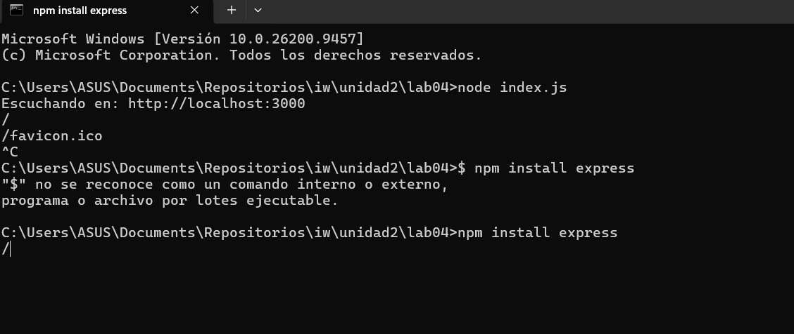
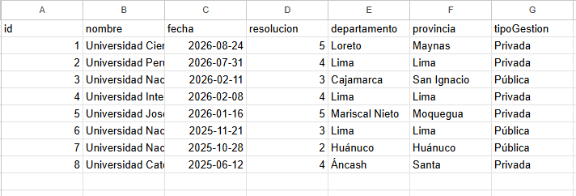
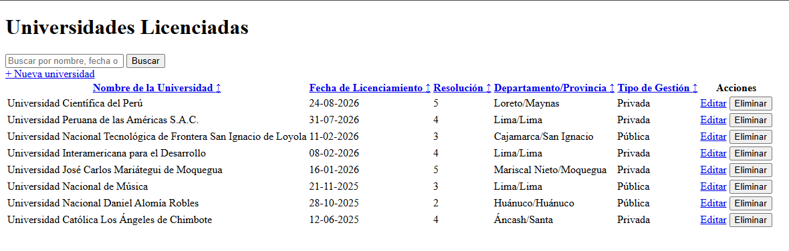
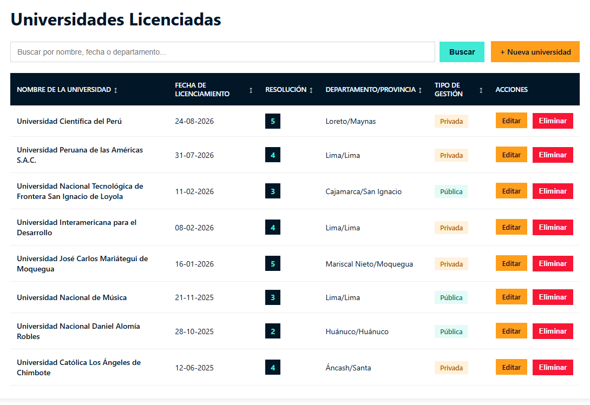
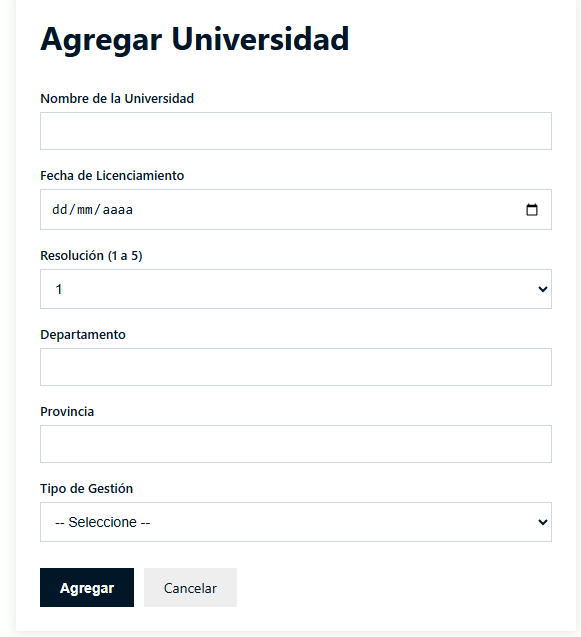

# Lab 04

Aplicación web para gestionar (crear, leer, actualizar, eliminar y buscar) un listado
de universidades licenciadas.

## Integrantes 

- Sebastian David
- Joaquin Torres
- Joel Choquepata

## Instalacion de npm

Comando "npm install"

## Crear csv

## Funciones 

- **Listar**: `GET /` muestra la tabla con todas las universidades.
- **Buscar**: `GET /?q=texto` filtra por nombre, departamento, provincia o tipo
  de gestión. Se usa el método **GET**, por lo que la búsqueda queda en la URL
  (se puede copiar/compartir/recargar).
- **Ordenar**: clic en cualquier encabezado de columna (usa `GET` con `sort` y `dir`).
- **Crear**: botón "+ Nueva universidad" -> formulario -> `POST /universidades`.
- **Editar**: botón "Editar" en cada fila -> formulario prellenado -> `POST /editar/:id`.
- **Eliminar**: botón "Eliminar" en cada fila -> `POST /eliminar/:id` (con confirmación).

## Front

Sin css:

Con css:

Formulario:

## Editar el CSV directamente

Como los datos viven en `data/universidades.csv`, también puedes abrirlo y
editarlo a mano con Excel, Google Sheets o un editor de texto — los cambios se
reflejarán la próxima vez que la app lea el archivo (por ejemplo, al recargar
la página).

## Notas

- No se incluye `node_modules/` (se genera con `npm install`).
- Se cambio al puerto desginado "8088"