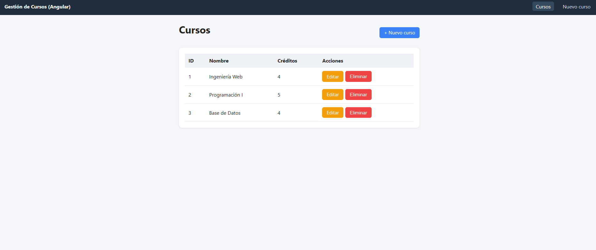
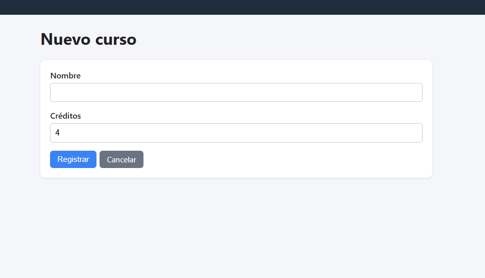
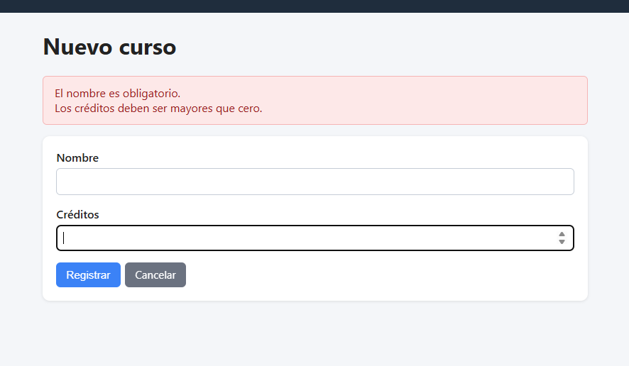
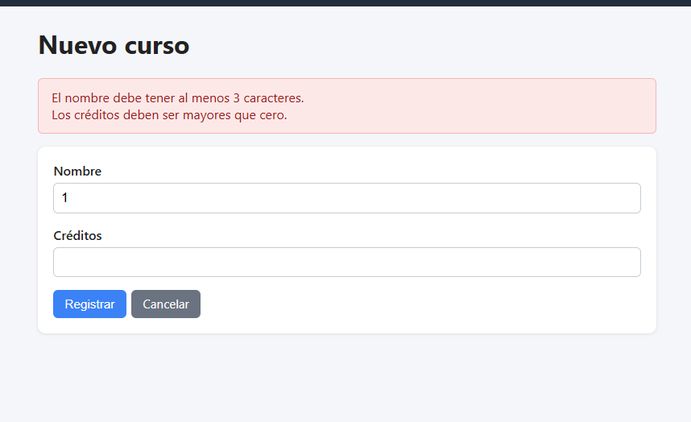
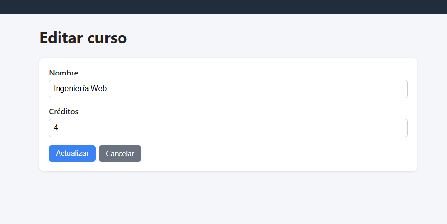
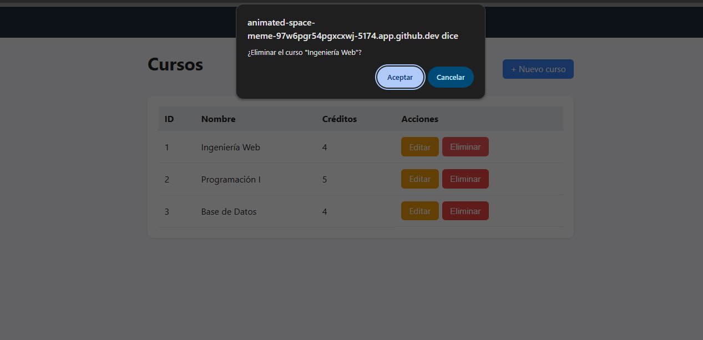

# Integrantes
- Joaquin Torres
- Joel Choquepata
- Sebastian David
- Franco Rojas

## 1. Estructura del repositorio

```text
lab-frontend-frameworks/
├── setup.sh             
├── backend/              # API REST 
├── frontend-vue/         # Vue 3 
├── frontend-angular/     # Angular
└── frontend-react/       # React
```

## 2. Cómo ejecutar

Requisitos: Node.js LTS, npm y Git.

```bash
bash setup.sh        # una sola 
```

Luego, en **cuatro terminales**:

| Terminal | Comandos | URL |
|---|---|---|
| Backend | `cd backend && npm run dev` | http://localhost:3000/api/cursos |
| Vue | `cd frontend-vue && npm run dev` | http://localhost:5173 |
| Angular | `cd frontend-angular && npx ng serve` | http://localhost:4200 |
| React | `cd frontend-react && npm run dev` | Vite indica el puerto (5174 si el 5173 está ocupado) |

> El backend usa `cors()`, por lo que los tres frontends pueden consumirlo aunque estén en puertos distintos.

## 3. Funcionalidades implementadas (en los tres frameworks)

| Funcionalidad | Vue.js | Angular | React |
|---|---|---|---|
| Listar cursos (GET) | ✅ | ✅ | ✅ |
| Registrar curso (POST) | ✅ | ✅ | ✅ |
| Actualizar curso (PUT) | ✅ | ✅ | ✅ |
| Eliminar curso (DELETE) con confirmación | ✅ | ✅ | ✅ |
| Navegación con rutas (`/`, `/nuevo`, `/editar/:id`) | Vue Router | Angular Router | React Router |
| Menú de navegación y diseño responsive (CSS) | ✅ | ✅ | ✅ |
| Validaciones (nombre ≥ 3 caracteres, créditos > 0) | ✅ | ✅ | ✅ |
| Mensaje de error si la API no está disponible | ✅ | ✅ | ✅ |

Las validaciones también existen en el backend (`400 Bad Request`), de modo que la API se protege aunque el cliente falle.

## 4. Evidencias (completar)

1. URL del repositorio: `https://github.com/<usuario>/lab-frontend-frameworks`
2. Capturas de Vue funcionando: _(listar, registrar, editar, eliminar)_
3. Capturas de Angular funcionando: _(listar, registrar, editar, eliminar)_
4. Capturas de React funcionando: _(listar, registrar, editar, eliminar)_
5. Captura de la validación y del error con la API apagada.

## 5. Imagenes de Demostracion
Imagen del modelo que usamos en las interfaces



Imagen de interfaz para crear un curso



Imagenes de las excepciones usadas en las interfaces




Imagen de Interfaz de editar curso



Imagen de validacion para borrar



## 6. Preguntas de evaluación

**1. ¿Qué diferencias existen entre Angular, Vue.js y React respecto a su arquitectura?**  
Angular es un framework completo: incluye routing, HTTP, formularios, inyección de dependencias y testing, con una estructura fija basada en TypeScript. Vue es progresivo: el núcleo se ocupa de la vista y se agregan Router o Pinia cuando hacen falta; usa plantillas HTML con reactividad automática. React solo se encarga de la capa de interfaz mediante componentes funcionales y un flujo de datos unidireccional; el resto (rutas, HTTP, estado global) se elige aparte.

**2. ¿Qué ventajas ofrece Vue Router frente a implementar navegación manual?**  
Permite declarar las rutas en un solo lugar, cambiar de vista sin recargar la página (SPA), usar la API History del navegador (botones atrás/adelante y URLs compartibles), recibir parámetros como `/editar/:id`, y contar con guardias de navegación, rutas anidadas y carga diferida. Hacerlo a mano exigiría gestionar la URL, el historial y la vista activa por cuenta propia.

**3. ¿Qué ventajas ofrece Axios para consumir servicios REST?**  
Una API simple basada en promesas, conversión automática a JSON, `baseURL` y cabeceras comunes con `axios.create`, interceptores para manejo centralizado de errores o tokens, y rechazo automático de la promesa ante códigos 4xx/5xx (con `fetch` hay que revisar `response.ok` manualmente).

**4. ¿Qué diferencias existen entre Axios y HttpClient de Angular?**  
Axios es una librería externa independiente del framework y devuelve **Promesas**. `HttpClient` viene integrado en Angular, devuelve **Observables** (RxJS), se integra con la inyección de dependencias y los interceptores del framework, y ofrece tipado genérico (`get<Curso[]>`). Las peticiones de `HttpClient` son perezosas: no se envían hasta que alguien hace `subscribe`.

**5. ¿Qué ventajas presenta el uso de componentes reutilizables?**  
Evitan duplicar código (por ejemplo, el formulario de este laboratorio sirve para crear y editar), facilitan el mantenimiento, ya que un cambio se refleja en todos los lugares donde se usa, mejoran la consistencia visual, permiten probar piezas aisladas y facilitan el trabajo en equipo.

**6. ¿Qué diferencias existen entre `v-model`, `[(ngModel)]` y el manejo de estado con `useState`?**  
- `v-model` (Vue): enlace bidireccional automático entre un `ref` y el campo; la plantilla y el dato se sincronizan sin código adicional.  
- `[(ngModel)]` (Angular): enlace bidireccional que requiere importar `FormsModule`; combina la propiedad (`[ngModel]`) y el evento (`(ngModelChange)`).  
- `useState` (React): no hay enlace bidireccional. Se usa un *componente controlado*: `value={estado}` y `onChange={e => setEstado(e.target.value)}`. Es más explícito, pero requiere más código.

**7. ¿Qué framework consideras más adecuado para aplicaciones empresariales? Justifica.**  
Angular es una opción muy adecuada: ofrece una estructura uniforme, TypeScript por defecto, inyección de dependencias, formularios robustos y herramientas de CLI, lo que facilita mantener proyectos grandes con muchos desarrolladores durante años. React también es muy usado en empresas por su ecosistema y la gran cantidad de profesionales, aunque exige definir más convenciones. Vue encaja bien en equipos pequeños o medianos. La elección final depende del equipo y del proyecto.

**8. ¿Qué dificultades encontraste al implementar la misma aplicación en los tres frameworks?** *(ajusta con tu experiencia personal)*  
- Angular: más código base (servicios, decoradores, rutas) y entender los Observables y Signals.  
- Vue: distinguir `ref` (`.value` en el script, sin `.value` en la plantilla) y recordar `.prevent` en el envío del formulario.  
- React: escribir manualmente el enlace de cada input y manejar `useEffect` y sus dependencias.  
- En general: puertos distintos para cada app (CORS), mantener el backend encendido y repetir la misma lógica con tres sintaxis.

## 7. Conclusiones

- Los tres frameworks consumieron **la misma API REST** sin cambios en el backend.
- **Angular** aporta una estructura integrada y un conjunto amplio de herramientas, a costa de mayor complejidad inicial.
- **Vue.js** permite construir interfaces de forma progresiva, con una sintaxis accesible y menos código.
- **React** ofrece máxima flexibilidad mediante componentes y hooks, pero deja más decisiones al equipo.
- La elección depende de las necesidades del proyecto, la experiencia del equipo y la arquitectura de la aplicación.
