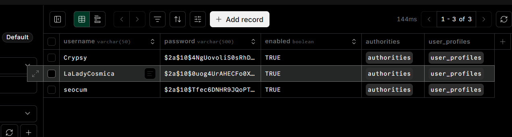
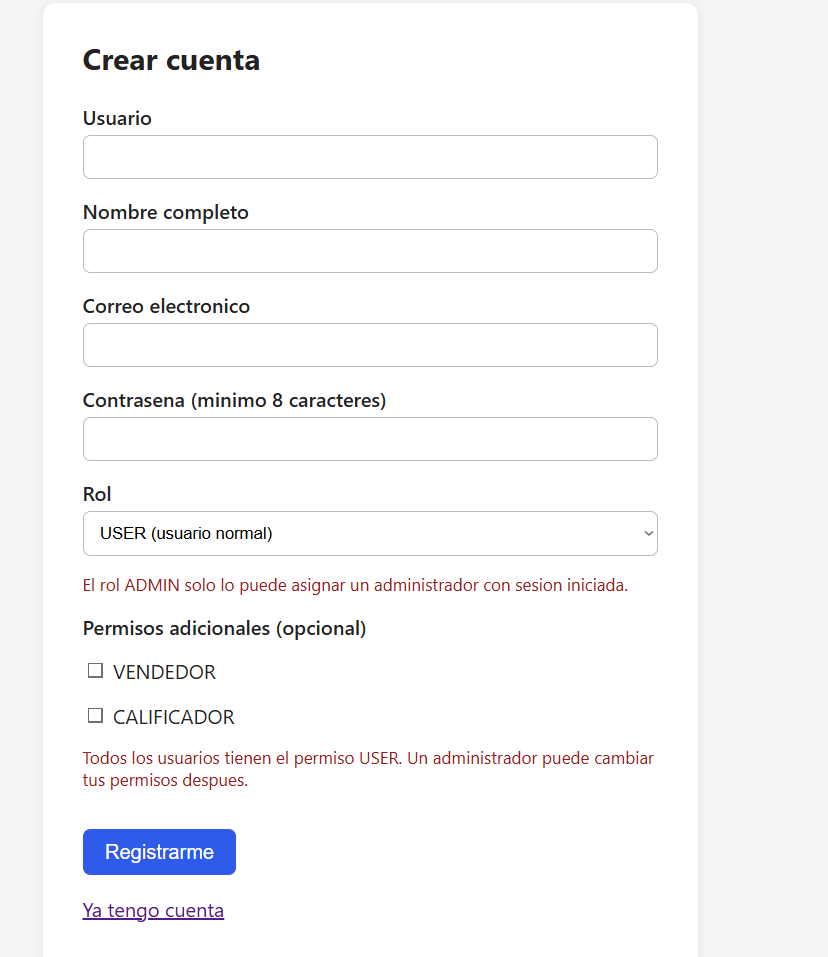
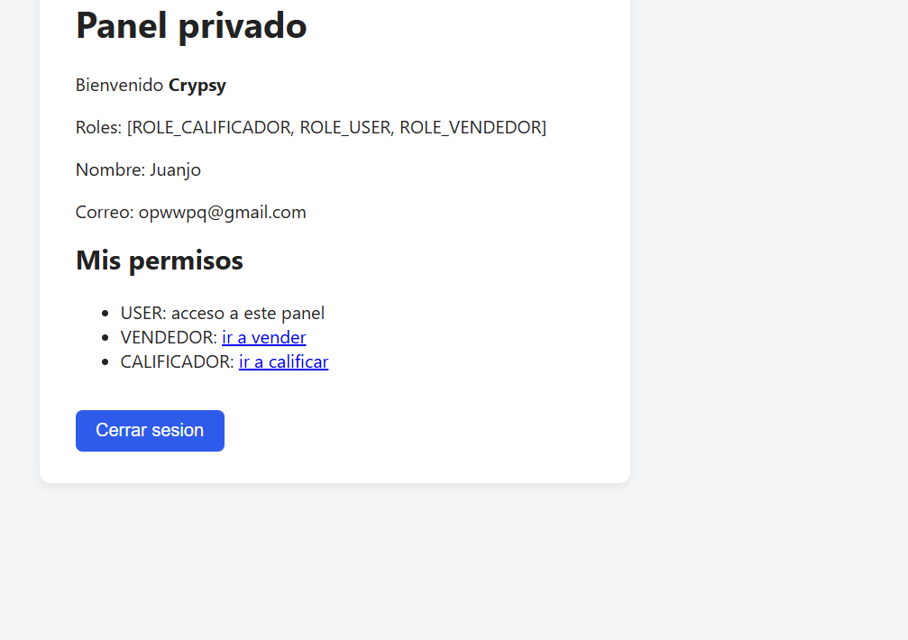
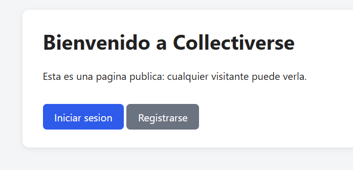
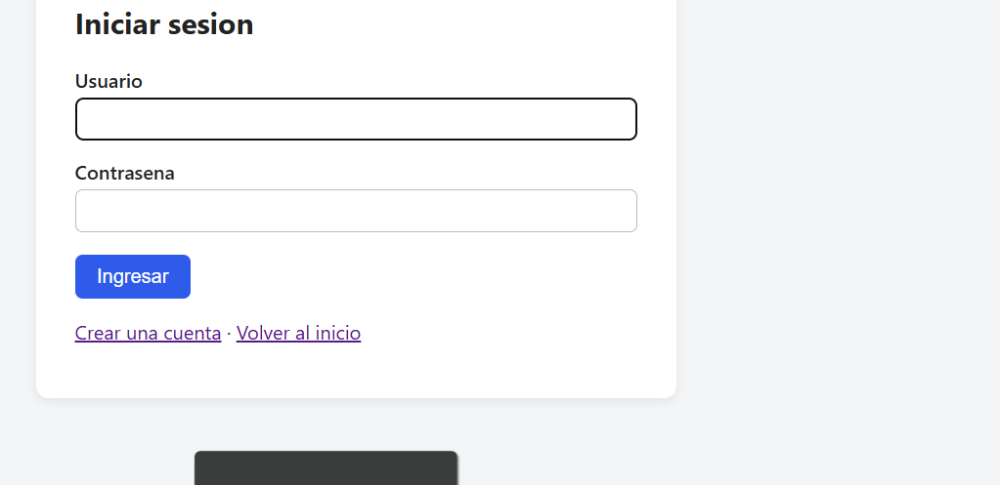
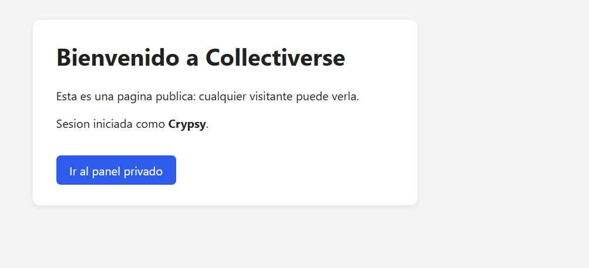

# Lab 08 – Seguridad web con Spring Security (Collectiverse)

Laboratorio de Ingeniería Web (Unidad 3). Se implementa autenticación y autorización por roles/permisos sobre el proyecto **Collectiverse**, una aplicación web hecha con Spring Boot y plantillas HTML.

## Objetivo

- Permitir que los usuarios se registren e inicien sesión.
- Proteger páginas según el rol o permiso del usuario.
- Ofrecer un panel de administración para gestionar los permisos de los demás usuarios.

## Tecnologías

- Java + Spring Boot
- Spring MVC (controladores y vistas HTML)
- Spring Security (autenticación y reglas de acceso)
- Jakarta Validation (validación del formulario de registro)

## Estructura relevante

```
collectiverse/src/main/java/com/collectiverse/collectiverse/
├── controller/
│   └── PaginasController.java      # Páginas HTML: pública, login, registro, privada y admin
├── security/registro/
│   ├── Permisos.java               # Permisos autoasignables y asignables por un admin
│   ├── PermisosAdminService.java   # Listar y actualizar permisos de usuarios
│   ├── RegistroForm.java           # Formulario de registro
│   └── RegistroService.java        # Lógica de registro de usuarios
├── dominio/repository/
│   └── RepoUserProfile.java        # Acceso a los perfiles de usuario
└── cu/shared/exception/
    └── ConflictException.java      # Error por usuario duplicado
```

Las reglas de acceso por ruta están definidas en `SecurityConfig`.

## Rutas y niveles de acceso

| Ruta | Método | Acceso | Descripción |
|------|--------|--------|-------------|
| `/` | GET | Público | Página de inicio |
| `/login` | GET | Público | Formulario de login (el POST lo procesa Spring Security) |
| `/registro` | GET / POST | Público | Registro de nuevos usuarios |
| `/bienvenida` | GET | Autenticado | Página a la que se llega tras iniciar sesión |
| `/privado` | GET | Autenticado | Muestra usuario, roles y perfil |
| `/vender` | GET | Permiso `VENDEDOR` | Página exclusiva para vendedores |
| `/calificar` | GET | Permiso `CALIFICADOR` | Página exclusiva para calificadores |
| `/admin` | GET | Rol `ADMIN` | Lista usuarios y permite editar sus permisos |
| `/admin/usuarios/{username}/permisos` | POST | Rol `ADMIN` | Actualiza los permisos de un usuario |

## Funcionamiento

### Registro
- El formulario (`RegistroForm`) se valida con `@Valid`.
- Al registrarse se ofrecen únicamente los permisos autoasignables (`Permisos.AUTOASIGNABLES`).
- Solo un **ADMIN autenticado** puede crear otro usuario ADMIN (atributo `puedeElegirAdmin` en las vistas).
- Si el usuario ya existe se lanza `ConflictException` y se muestra el error en el formulario.
- Tras un registro exitoso se redirige a `/login?registrado`.

### Login
- `GET /login` muestra el formulario; la autenticación la gestiona Spring Security.
- Tras iniciar sesión se llega a `/bienvenida`.

### Panel de administración
- `/admin` lista los usuarios y los permisos que un admin puede asignar (`Permisos.ASIGNABLES_POR_ADMIN`).
- Al guardar, se muestran mensajes de confirmación o aviso mediante *flash attributes*.
- **Protección:** un admin no puede quitarse a sí mismo el rol `ADMIN`, para evitar quedarse sin acceso al sistema.

## Base de datos

La aplicación usa una base de datos PostgreSQL alojada en [Neon](https://neon.tech) (`neondb`).

- Consola (tablas): <https://console.neon.tech/app/projects/winter-feather-96998070/branches/br-cool-math-b5tqd4r6/tables?database=neondb>

## Imagenes











## Cómo ejecutar

```bash
cd collectiverse
./gradlew bootRun
```

Luego abrir <http://localhost:8080>.

## Pruebas sugeridas

1. Registrar un usuario con permiso `VENDEDOR` e ingresar a `/vender` (permitido) y a `/calificar` (denegado).
2. Intentar abrir `/privado` sin sesión: debe redirigir a `/login`.
3. Ingresar como ADMIN, abrir `/admin` y cambiar los permisos de otro usuario.
4. Como ADMIN, intentar quitarse el propio rol `ADMIN`: debe mostrar el aviso y conservarlo.

## Autor

Sebastián David  
Joel Choquepata
Franco Rojas
Joaquin Torres
