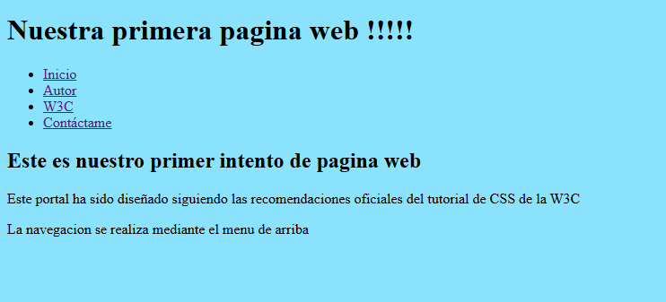
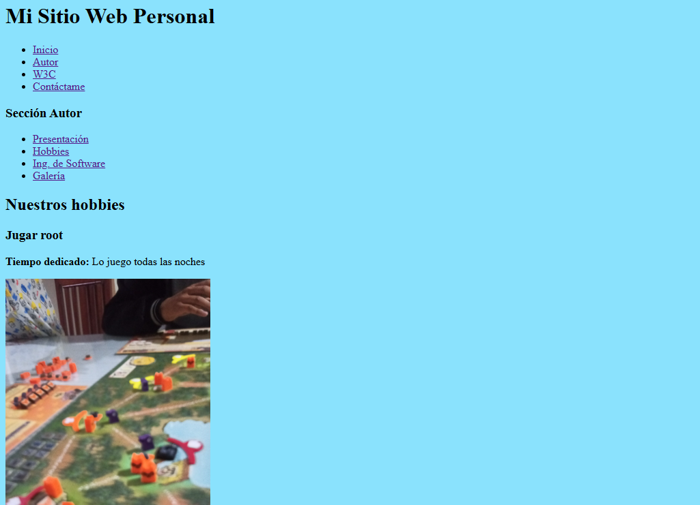
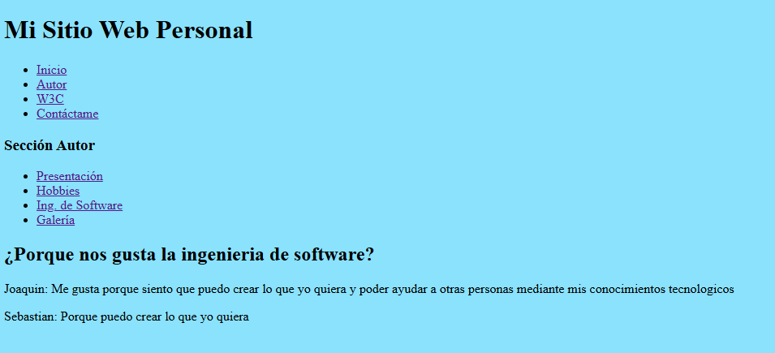

# Laboratorio 1

## Creación del index 

- En el index pusimos el color de la página los menús vacíos para la arquitectura y un comentario de que es nuestra primera página

## Agregar hobbies
- Aquí agregamos las imágenes de nuestros hobbies

## Respondemos la pregunta 
- Agregamos porque nos gusta la carrera

- Commit de la página antes de la mejora visual con las imágenes de los hobbies, con menus llenos y la pregunta resuelta

## Mejora del estilo visual
- Mejora del estilo visual de la pagina

## Que aporto la clase

Las 3 cosas que nos aporto la clase fue:
- Un conocimiento base para crear una página web 
- Manejar mejor el estilo visual de una página
- Conocer los estándares de la W3C
