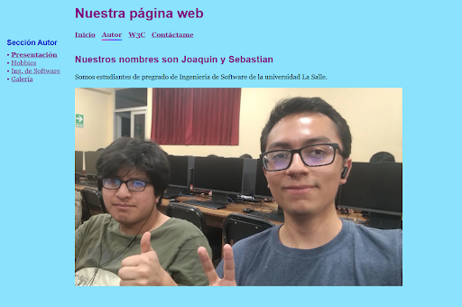
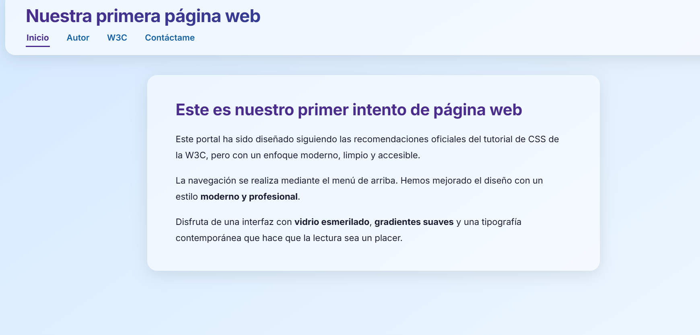

# Laboratorio 1

## Creación del index 

- En el index pusimos el color de la página los menús vacíos para la arquitectura y un comentario de que es nuestra primera página

## Agregar hobbies
- Aquí agregamos las imágenes de nuestros hobbies

## Respondemos la pregunta 
- Agregamos porque nos gusta la carrera

- Commit de la página antes de la mejora visual con las imágenes de los hobbies, con menus llenos y la pregunta resuelta: https://github.com/sebastian-david-pizango/iw/commit/e0a8502272cd6649d5e7aece1feb6e76a5bf1b7b

## Mejora del estilo visual
- Mejora del estilo visual de la pagina 

- Commit con la mejora de la pagina con css: https://github.com/sebastian-david-pizango/iw/commit/a3b8a4e98e50c34d3db25633b672ae5e5af8322c

## Segunda mejora visual
- El estilo visual anterior no nos convencio y lo cambiamos 

## Que aporto la clase

Las 3 cosas que nos aporto la clase fue:
- Un conocimiento base para crear una página web 
- Manejar mejor el estilo visual de una página
- Conocer los estándares de la W3C

