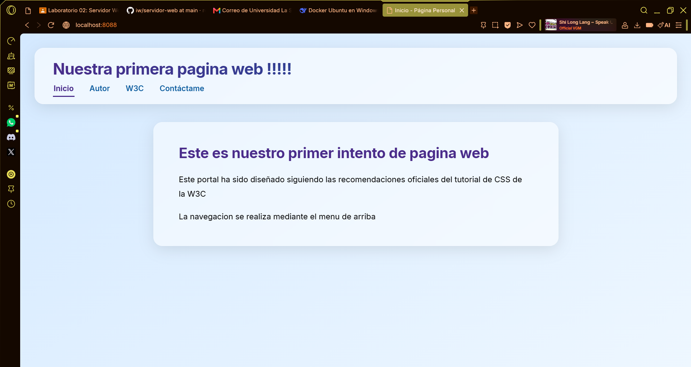
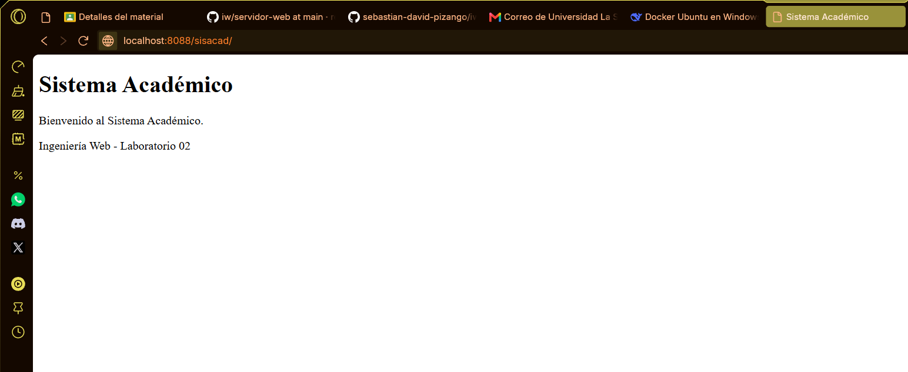
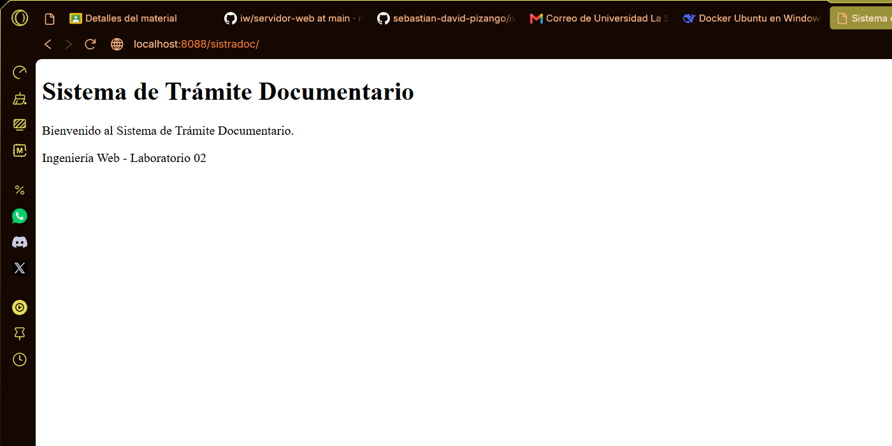

# Laboratorio 2

## Parte 1 

- Acá en la parte uno agregamos la página del Laboratio 1 y lo metimos en una imágen

- Parte 1 commit: https://github.com/sebastian-david-pizango/iw/commit/8f242388b0bef9bc7f798ea8f3d2f2b430f560be

## Parte 2

- En la parte 2 agregamos las dos páginas extra sisacad y sistramud 

- Parte 2 commit: https://github.com/sebastian-david-pizango/iw/commit/acba346684a9f700693e271d50c9b73b8f190508

 

